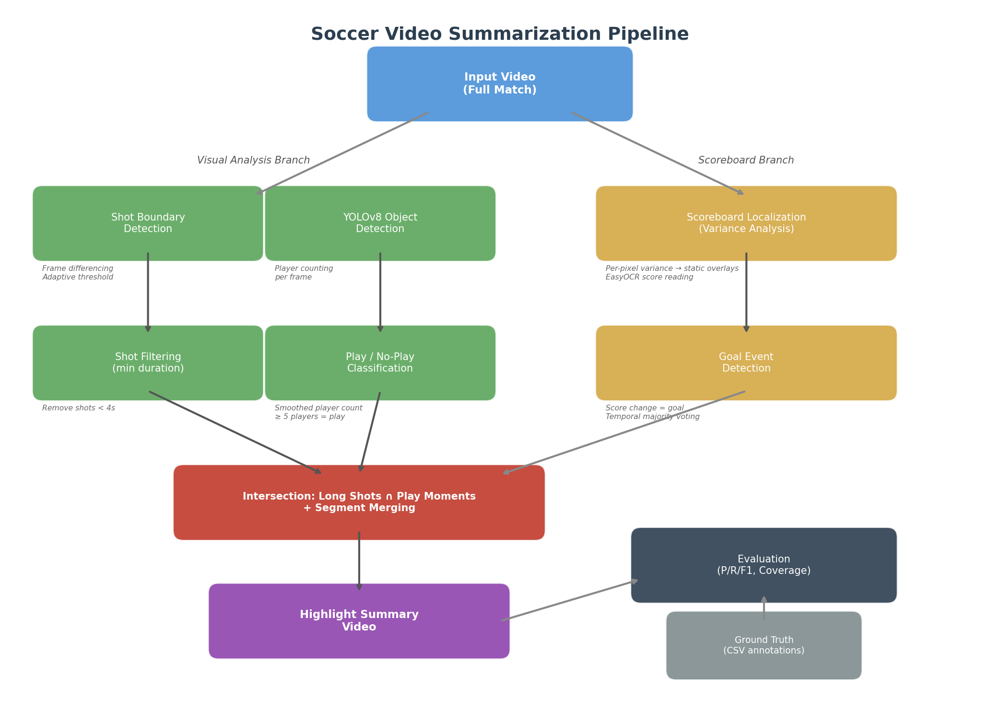
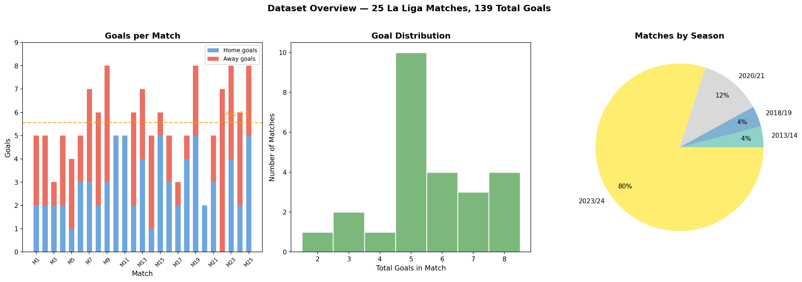
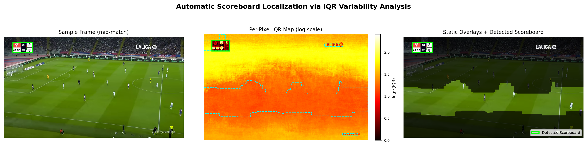
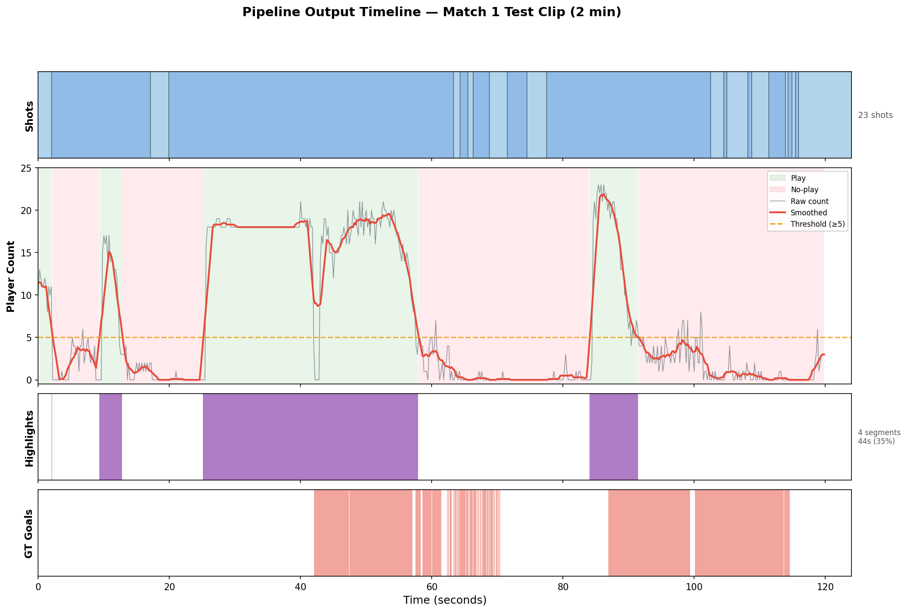

# Automatic Soccer Video Summarization

A modular pipeline for automatic highlight extraction from full-length soccer broadcast footage. The system combines shot boundary detection, YOLOv8-based play/no-play classification, and OCR-based scoreboard reading to produce concise video summaries centered around goal events.



## Background

This project originates from a Master's thesis (TFM) by Lixing Fan at Universidad Politécnica de Madrid, titled *"Development of a Deep Learning Model for Video Summarization of Soccer Matches"*. The thesis explored multiple approaches (multimodal fusion, CLIP embeddings, transformer-based methods, WhisperX audio transcription) before converging on a pragmatic pipeline that combines visual analysis with scoreboard OCR. The original codebase was scattered across many experimental files. This repository is a clean, modular rewrite of the working components, designed to scale evaluation across 25 La Liga matches and produce journal-quality results.

## Dataset



- **25 full La Liga matches** (Match1 through Match25), spanning seasons 2013/14 to 2023/24
- **138 total goals** across all matches (average 5.5 goals/match), ranging from 2-goal to 8-goal matches
- **Ground truth**: 25 CSV files with commentary-level annotations. Each row is a commentary segment with columns: `start`, `end`, `text`, `GoalGT1`, `GoalGT2` (binary flags indicating whether the segment overlaps with a goal event for each team)
- **Trained model**: YOLOv8 Medium (`best.pt`) with 4 classes (ball, goalkeeper, player, referee). mAP@50 = 0.929. People classes (goalkeeper + player + referee) are aggregated for player counting

## Pipeline Architecture

The system operates in two parallel branches that converge at the highlight assembly stage:

### 1. Shot Boundary Detection

Detects camera cuts by computing the mean absolute difference between consecutive grayscale frames. Uses an adaptive threshold with local maximum detection:

$$\tau = \max(\tau_{\text{fixed}},\ \mu + k \cdot \sigma)$$

where $\mu$ and $\sigma$ are the mean and standard deviation of frame differences, and $k=2.0$ by default. Multiprocessing is used to parallelize frame loading across CPU cores. A minimum shot length constraint (10 frames) prevents false positives from flickering or compression artifacts.

### 2. YOLOv8 Object Detection

A YOLOv8 Medium model counts the number of visible players per frame. The model was trained on a consolidated Roboflow dataset of 45,080 images with 4 classes (ball, goalkeeper, player, referee). For player counting, all person classes (`{goalkeeper, player, referee}`) are aggregated.

To reduce computational cost, YOLO runs on every 5th frame (effective 5 fps at 25 fps video), which is sufficient for reliable player counting.

### 3. Play/No-Play Classification

Classifies each time segment as active play or dead time (replays, close-ups, crowd shots, etc.) based on the number of visible players:

1. **Interpolation**: Fill gaps from frame-sampled YOLO data to all frames
2. **Smoothing**: Apply 50-frame rolling average to the player count signal
3. **Thresholding**: Frames with $\geq 5$ smoothed players are classified as "play"
4. **Segmentation**: Group consecutive same-label frames into play/no-play segments

The intuition is simple: wide-angle game footage typically shows 15-22 players, while replays, close-ups, and crowd shots show 0-3 players.

### 4. Automatic Scoreboard Localization (OCR)



Replaces hardcoded pixel coordinates with **automatic scoreboard localization via IQR variability analysis**:

1. **Build IQR variability map** — Sample ~200 frames spread evenly across the match and compute the per-pixel interquartile range (P75 − P25) in grayscale. Static overlays (scoreboard, channel logo, clock) have near-zero IQR while the game action underneath changes constantly. IQR is used instead of standard deviation because it is robust to outlier frames (halftime, replays, intros) where the scoreboard is absent — even 5% of such frames can make std misclassify static pixels as high-variance.
2. **Build overlay mask** — Threshold the IQR map at the 8th percentile to produce a binary mask of static pixels. Apply morphological closing (51×21 kernel, 2 iterations) to bridge gaps at digit/clock positions, then opening (9×9) to remove noise. Extract connected components as candidate regions.
3. **Split and tighten candidates** — Regions wider than 40% of the frame are split by finding significant vertical gaps (30+ empty columns) in the raw (pre-closing) mask. All candidate bounding boxes are tightened to the actual raw mask content, reversing the inflation from morphological closing.
4. **Identify scoreboard** — Run EasyOCR on each candidate region (upscaled 4x for better digit recognition) from 3 mid-match frames. Regions are scored by OCR content: score patterns like "2-1" (+10), team abbreviations (+5), clock patterns (+3), any digit (+1), league branding like "LALIGA" (−10). The highest-scoring region is the scoreboard.
5. **Track score changes** — Sample 1 frame every 3 seconds, crop only the cached scoreboard region (with 15px padding), run OCR on the small crop. OCR readings whose center falls outside the scoreboard bounding box within the padded crop are discarded, filtering out jersey numbers and advertising text that leak into the padding area. Two parsing strategies are used:
   - **"X-Y" pattern matching** for classic score formats (e.g., "2-1", common in 2013-2018 broadcasts). Includes dot-to-dash normalization (`"2.3"` → `"2-3"`) since OCR often misreads the tiny dash separator as a dot in older broadcasts
   - **Position-cluster tracking** for modern formats where home and away scores appear as separate digits at fixed positions (common in 2020+ broadcasts)
6. **Robustness filters** — Multiple filters prevent false detections:
   - **Layout detection**: Relative spatial spread (`dy > dx`) distinguishes vertical from horizontal scoreboard layouts
   - **Temporal median filter**: Per-cluster sliding window (15 readings) removes transient stat overlay spikes (e.g., when the scoreboard temporarily shows possession or throw counts instead of goals)
   - **Monotonic score enforcement**: After filtering, scores are clamped to a running maximum so they never decrease — real football scores only go up
   - **Cluster concentration filter**: Rejects clusters with uniform digit distributions (clock positions) and static non-zero elements (channel branding)
   - **Forward persistence validation**: Score transitions must persist for 8+ future readings (~24 seconds) to be accepted, with event timestamps backtracked to the first raw OCR frame showing the new score for precise timing
   - **Max jump constraint**: Only accepts score transitions where total change is $\leq 2$, filtering large stat overlay jumps

This approach works regardless of scoreboard position (top, bottom, corner), layout orientation (horizontal or vertical), and handles different broadcasters and seasons automatically.

### 5. Highlight Assembly

Computes the intersection of long shots and play moments:

1. **Filter short shots**: Remove shots shorter than 4 seconds
2. **Intersect**: Keep only segments that are both a long shot AND classified as play
3. **Merge**: Combine adjacent segments with gaps $\leq 0.5$ seconds

### Example Output

The figure below shows the pipeline output for a 2-minute test clip from Match 1 (Valencia 2-3 FC Barcelona, 2013/14). From top to bottom: detected shot boundaries, player count with play/no-play classification, extracted highlights, and ground truth goal annotations.



The pipeline correctly identifies play moments (green) where 5+ players are visible, distinguishing them from replays and close-ups (pink). The 4 highlight segments total 44 seconds (35% of the clip), achieving 65% compression while covering the active play periods.


## Project Structure

```
soccer_summarization/          # Core Python package
    __init__.py
    config.py                  # YAML-based configuration with dataclasses
    shot_segmentation.py       # Shot boundary detection with multiprocessing
    object_detection.py        # YOLOv8 inference and per-frame player counting
    play_classifier.py         # Play/no-play classification with smoothing
    ocr_scoreboard.py          # Adaptive scoreboard localization and OCR
    highlight_assembler.py     # Shot filtering, intersection, segment merging
    evaluation.py              # Metrics: P/R/F1, compression ratio, goal coverage
    utils.py                   # Time formatting, video I/O helpers

scripts/                       # Entry points and analysis
    run_single_match.py        # Process one match end-to-end
    run_all_matches.py         # Batch processing with intermediate caching
    evaluate.py                # Run evaluation against ground truth
    run_baselines.py           # Run 6 internal baselines (random, uniform, shot-only, etc.)
    run_ablation.py            # Run 7 parameter ablation studies
    run_component_analysis.py  # Component contribution analysis
    error_analysis.py          # TP/FP/FN categorization per match
    statistical_analysis.py    # Wilcoxon signed-rank tests + Cliff's delta
    generate_figures.py        # Generate journal-quality figures
    generate_tables.py         # Generate LaTeX-ready result tables
    generate_debug_visuals.py  # Visual debug outputs for each pipeline stage
    visualize_ocr_diagnostics.py  # Per-match OCR diagnostic images

config/                        # Configuration files
    default.yaml               # Default hyperparameters and thresholds
    matches.yaml               # Per-match metadata (video path, GT, teams, score)

docs/figures/                  # Generated figures for documentation
results/                       # Auto-populated by the pipeline
    per_match/                 # One directory per match with all intermediates
    aggregate/                 # Summary tables, plots, aggregate metrics
    ocr_diagnostics/           # Per-match OCR diagnostic images
    baselines/                 # Baseline comparison results
    ablation/                  # Parameter ablation results
    component_analysis/        # Component contribution analysis
    error_analysis/            # TP/FP/FN categorization
    statistical/               # Statistical test results
    figures/                   # Generated PDF figures
    tables/                    # Generated LaTeX tables
```


## Installation

```bash
# Clone the repository
git clone <repository-url>
cd Soccer-Video-Summarization

# Create virtual environment
python3 -m venv venv
source venv/bin/activate

# Install dependencies
pip install ultralytics opencv-python easyocr pandas numpy matplotlib pyyaml tqdm scipy
```

### Requirements

- Python 3.10+
- CUDA-capable GPU (recommended for YOLO and EasyOCR)
- `ultralytics` (YOLOv8)
- `opencv-python`
- `easyocr` (PyTorch-based OCR)
- `pandas`, `numpy`, `matplotlib`
- `scipy` (statistical tests)
- `PyYAML`
- `tqdm`


## Usage

### Process a single match

```bash
# Using match ID from matches.yaml
python scripts/run_single_match.py --match-id Match1

# Using explicit paths
python scripts/run_single_match.py --video /path/to/video.mp4 --gt /path/to/gt.csv

# Skip OCR (faster, uses only visual analysis)
python scripts/run_single_match.py --match-id Match1 --skip-ocr

# Skip video export (only compute intermediates and metrics)
python scripts/run_single_match.py --match-id Match1 --skip-video-export
```

### Process all 25 matches

```bash
# All matches
python scripts/run_all_matches.py

# Specific matches
python scripts/run_all_matches.py --matches Match1,Match5,Match10

# Skip OCR for all (much faster)
python scripts/run_all_matches.py --skip-ocr --skip-video-export
```

### Evaluate from saved results

```bash
# Re-evaluate without re-running the pipeline
python scripts/evaluate.py

# Specific matches
python scripts/evaluate.py --matches Match1,Match2,Match3
```

### Run analysis scripts

```bash
# Baselines comparison
python scripts/run_baselines.py

# Parameter ablation studies
python scripts/run_ablation.py

# Component contribution analysis
python scripts/run_component_analysis.py

# Error analysis (TP/FP/FN categorization)
python scripts/error_analysis.py

# Statistical significance tests (Wilcoxon + Cliff's delta)
python scripts/statistical_analysis.py

# Generate figures and tables
python scripts/generate_figures.py
python scripts/generate_tables.py

# OCR diagnostics (IQR map, overlay mask, annotated frames, score timeline)
python scripts/visualize_ocr_diagnostics.py
python scripts/visualize_ocr_diagnostics.py --matches Match1,Match5,Match10
```

### Pipeline outputs (per match)

Each processed match produces the following files in `results/per_match/MatchN/`:

| File | Description |
|------|-------------|
| `shot_boundaries.csv` | Shot segments with start/end frames and times |
| `player_counts.csv` | Per-frame player count from YOLO |
| `frame_classification.csv` | Per-frame play/no-play classification |
| `play_segments.csv` | Play/no-play segments with durations |
| `score_events.csv` | Detected score changes from OCR |
| `scoreboard_region.json` | Detected scoreboard bounding box |
| `highlights.csv` | Final highlight segments |
| `highlight_video.mp4` | Exported highlight video |
| `evaluation.json` | All metrics (P/R/F1, compression, coverage, timings) |

All intermediate results are cached — re-running the pipeline on the same match will skip completed stages.


## Evaluation Methodology

### Goal Detection Metrics

Ground truth goal events are extracted by grouping consecutive `GoalGT=1` commentary segments. A new goal event starts when the gap between consecutive flagged segments exceeds 30 seconds.

A predicted goal (from OCR score change) matches a ground truth event if it falls within a tolerance window of $\pm 30$ seconds around the event boundaries. Standard precision, recall, and F1 are computed. Both macro-averaged (per-match mean) and micro-averaged (pooled across all matches) metrics are reported.

### Highlight Quality Metrics

| Metric | Definition |
|--------|-----------|
| **Compression ratio** | $1 - \frac{\text{highlight duration}}{\text{video duration}}$ — fraction of the video removed |
| **Goal coverage** | Fraction of ground truth goal-event time captured in highlights |
| **Mean tIoU** | Temporal Intersection over Union between predicted highlights and GT goal segments |
| **Goal timing MAE** | Mean absolute error between predicted goal timestamps and GT midpoints |
| **F1@tIoU** | F1 score at various tIoU thresholds (0.1, 0.3, 0.5, 0.7) |


## Results

### Aggregate Performance (25 matches)

| Metric | Value |
|--------|-------|
| Goal Detection F1 (macro) | 0.979 $\pm$ 0.056 |
| Goal Detection F1 (micro) | 0.975 |
| Precision (macro) | 0.983 $\pm$ 0.051 |
| Recall (macro) | 0.976 $\pm$ 0.063 |
| Compression | 32.7% $\pm$ 3.6% |
| Goal Coverage | 35.9% $\pm$ 9.6% |
| Mean tIoU | 0.210 $\pm$ 0.037 |
| Goal Timing MAE | 51.1s $\pm$ 9.8s |
| F1@tIoU=0.1 | 0.914 |

Out of 138 ground truth goals: 134 true positives, 3 false positives, 4 false negatives. 22 of 25 matches achieve perfect F1=1.00.

### Baselines

| Baseline | Mean F1 | vs. System |
|----------|---------|------------|
| Random Sampling | 0.000 | System significantly better ($p < 0.001$, large effect) |
| Uniform Sampling | 0.000 | System significantly better ($p < 0.001$, large effect) |
| Shot-Length Only | 0.000 | System significantly better ($p < 0.001$, large effect) |
| Play-Only | 0.000 | System significantly better ($p < 0.001$, large effect) |
| OCR-Only | 0.555 | Negligible difference |
| Oracle Upper Bound | 1.000 | — |

### Ablation Studies

| Parameter | Range | Default | Finding |
|-----------|-------|---------|---------|
| Player count threshold | 3–7 | 5 | Stable across range |
| Min shot duration | 3–7s | 4s | Negligible effect |
| Smoothing window | 25–100 frames | 50 | Stable across range |
| Tolerance window | 10–60s | 30s | Narrower windows reduce recall |
| OCR on/off | — | on | OCR drives all goal detection |


## Configuration

All hyperparameters are defined in `config/default.yaml`:

```yaml
shot_segmentation:
  threshold: 30.0              # Fixed threshold for frame differencing
  adaptive_k: 2.0             # Multiplier for adaptive threshold
  min_shot_length_frames: 10   # Minimum frames per shot

object_detection:
  model_path: "data/models/best.pt"
  confidence_threshold: 0.5
  frame_step: 5                # Process every 5th frame

play_classifier:
  play_threshold: 5            # Minimum players for "play"
  smoothing_window: 50         # Rolling average window (frames)

ocr_scoreboard:
  num_sample_frames: 200       # Frames for IQR variability map
  std_percentile: 8.0          # Bottom percentile of IQR → static overlay pixels
  min_region_area: 300         # Min pixels for a candidate overlay region
  closing_kernel: [51, 21]     # Morphological closing kernel (w, h)
  score_sample_interval: 3.0   # Seconds between OCR samples

highlight_assembler:
  min_shot_duration: 4.0       # Seconds
  merge_gap_threshold: 0.5     # Seconds
```

Match metadata (video paths, GT paths, teams, scores) is defined in `config/matches.yaml`.


## Baselines

| Baseline | Description | Purpose |
|----------|-------------|---------|
| **Random Sampling** | Random segments of equal total duration | Lower bound |
| **Uniform Sampling** | Evenly spaced segments across the match | Lower bound |
| **Shot-Length Only** | Keep shots > K seconds, no play/no-play filtering | Isolates YOLO contribution |
| **Play-Only** | Play segments without OCR | Isolates visual analysis |
| **OCR-Only** | Score change detection without highlight filtering | Isolates OCR contribution |
| **Oracle Upper Bound** | Perfect goal detection from GT | Upper bound |


## Original Thesis

Fan, L. (2024). *Development of a Deep Learning Model for Video Summarization of Soccer Matches*. Master's Thesis, Universidad Politécnica de Madrid.
